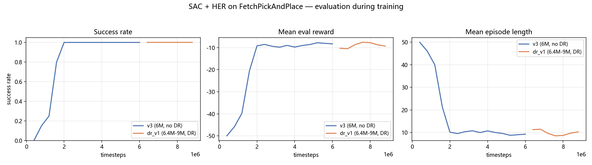
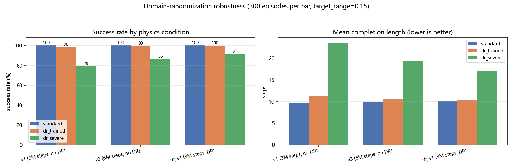

# SAC + HER on FetchPickAndPlace, with Domain-Randomization Fine-tuning

用 SAC + HER 解决 MuJoCo 机械臂抓取-放置任务(`FetchPickAndPlace-v4`),并在此基础上做**域随机化(domain randomization)微调**以提升对物理参数扰动的鲁棒性。

最终策略:标准环境成功率 **100%**、平均 **9.9 步**完成;在远超训练分布的物理扰动下仍保持 **91.3%** 成功率,而未经域随机化的基线只有 **86.3%**。

---

## 结果

### 训练曲线



- SAC+HER 在 **约 135 万步**成功率从 0 爬升到 100%,随后稳定保持
- 平均完成步数从 50(episode 上限)降到约 10 步
- `dr_v1`(橙)是域随机化微调段(640万→900万步),成功率全程维持 1.0

### 域随机化鲁棒性



三个模型 × 三种物理条件,每种 **300 局**,使用相同随机种子(每个模型面对完全相同的任务序列):

| 模型 | 标准物理 | 训练分布内 DR | 严苛 DR | **严苛条件下留存率** |
|---|---|---|---|---|
| v1 (3M 步, 无 DR) | 100.0% | 98.3% | 79.0% | **79.0%** |
| v3 (6M 步, 无 DR) | 100.0% | 99.3% | 86.3% | **86.3%** |
| **dr_v1 (9M 步, 含 DR)** | 100.0% | **99.7%** | **91.3%** | **91.3%** |

平均完成步数(越低越快):

| 模型 | 标准物理 | 训练分布内 DR | 严苛 DR |
|---|---|---|---|
| v1 (3M 步, 无 DR) | 9.74 | 11.25 | 23.54 |
| v3 (6M 步, 无 DR) | 9.93 | 10.64 | 19.42 |
| **dr_v1 (9M 步, 含 DR)** | 10.00 | 10.29 | **16.96** |

**关键结论**:物理参数超出训练分布后,三个模型都退化,但幅度差异显著。`dr_v1` 保留了 91.3% 的名义能力,基线 `v3` 只有 86.3%,更早的 `v1` 只有 79.0%;同时 `dr_v1` 比基线**快 2.46 步**完成任务。该差距在配对 t 检验(p=0.0002)和 Welch t 检验(p=0.0290)下均显著。

三种物理条件定义(`eval_dr.py:PHYSICS`):

| 条件 | 随机化范围 |
|---|---|
| `standard` | 无随机化,原始 MuJoCo |
| `dr_trained` | 质量 ×[0.4,1.8]、尺寸 ×[0.75,1.35]、摩擦 ×[0.5,1.5] — 与微调时所用配置完全一致 |
| `dr_severe` | 质量 ×[0.15,4.0]、尺寸 ×[0.55,1.9]、摩擦 ×[0.15,3.5] — 远超训练分布 |

### ⚠️ 一个必须说明的边界

**在训练分布内(`dr_trained` 列),域随机化微调带来的提升是 +0.3%、p=0.13,并不显著。**

也就是说:域随机化**没有**在训练所覆盖的范围内带来可测量的收益。它的价值只在物理参数越出训练分布时才体现出来。这个结论是数据给出的,不是预期结论——把它写在这里,而不是只挑显著的那一列展示。

要得到这个结论,必须先构造出足够严苛的条件:在标准环境和 `dr_trained` 下,三个模型全部是 100%,成功率完全无法区分(天花板效应)。

---

## 代码结构

| 文件 | 说明 |
|---|---|
| `The_first.py` | 主训练脚本。SB3 `SAC` + `HerReplayBuffer`(`future` 策略),4 路 `SubprocVecEnv` 并行,线性学习率衰减,成功即终止包装器 |
| `The_second.py` | **从零手写**的 SAC + 简化版 HER,不依赖 SB3 的算法实现。含高斯策略 + tanh 压缩(带 Jacobian 修正)、双 Q critic、future 目标重采样 |
| `domain_randomization.py` | 域随机化微调。`DomainRandomizationWrapper` 在每次 reset 时随机化物体质量/尺寸/摩擦;`ProgressiveDRCallback` 按成功率自适应提升随机化强度(课程学习) |
| `eval_dr.py` | **本仓库新增**。多进程并行评估,对比标准 / 训练分布 / 严苛三种物理条件,输出 Wilson 置信区间与配对/Welch t 检验 |
| `model_comp.py` | 多模型并行评估器,含 Welch t 检验显著性判断 |
| `demonstarte.py` | 加载模型并渲染可视化,跑 10 局并打印成功率 |

配套脚本(均从仓库根目录运行):

```bash
# 导出任意 TensorBoard event 文件为可读摘要
python tools/dump_tb.py tensorboard/dr_finetune

# 重跑域随机化对照评估并生成 results/results.md 与 results/results.json
# (约 1 分钟,300 局 × 3 模型 × 3 条件,6 进程并行)
python eval_dr.py -n 300 -j 6

# 重新生成两张图
python tools/plot_results.py
```

`eval_dr.py` 需要模型权重(见下节)。`tools/plot_results.py` 需要 `tensorboard/` 下的 event 文件——这些文件约 74 MB,未纳入 git,但 `results/` 下的 PNG 就是它的输出。

### 模型权重

仓库不含训练好的模型。最终模型 `sac_fetch_dr_v1.zip`(9,000,000 步)约 3.4 MB,通过 GitHub Release 分发,下载后放到 `model_2/` 下即可:

| 文件 | 步数 | 用途 |
|---|---|---|
| `sac_fetch_pickandplacev3.zip` | 6,000,000 | 基线模型(无域随机化) |
| `sac_fetch_dr_v1.zip` | 9,000,000 | 最终模型(含域随机化微调) |

`eval_dr.py` 的 `MODELS` 字典中可增删条目;若只下载了上述两个权重,请把 `v1 (3M steps, no DR)` 那一行删掉,否则会 `FileNotFoundError`。`demonstarte.py` 默认加载 `model_2/sac_fetch_dr_v1.zip`,同样需要先下载权重。


---

## 环境与依赖

```
python            3.13
gymnasium         1.2.3
gymnasium-robotics 1.4.2
stable-baselines3 2.8.0
mujoco            3.8.1
torch             2.11.0
numpy             2.4.4
scipy             1.17.1
```

```bash
pip install gymnasium==1.2.3 gymnasium-robotics==1.4.2 \
            stable-baselines3==2.8.0 mujoco==3.8.1 \
            torch numpy scipy matplotlib tensorboard
```

---

## 训练配置

主要超参(`The_first.py` / `domain_randomization.py`):

| 参数 | 值 |
|---|---|
| 环境 | `FetchPickAndPlace-v4` |
| 算法 | SAC + HER(`n_sampled_goal=2`, `goal_selection_strategy="future"`) |
| 策略网络 | `MultiInputPolicy` |
| 并行环境 | 4 × `SubprocVecEnv` |
| 学习率 | `LinearSchedule(3e-4 → 1e-5, end_fraction=0.8)` |
| buffer size | 2,000,000 |
| batch size | 256 |
| gamma | 0.92(训练) / 0.95(DR 微调) |
| tau | 0.005 |
| ent_coef | `auto_0.01` |
| 训练步数 | v1: 3M → v3: 6M → dr_v1: 9M(域随机化微调 3M) |

模型迭代路径(步数已从各 `.zip` 的元数据核实):

| 模型 | 累计训练步数 |
|---|---|
| `sac_fetch_pickandplacev1.zip` | 3,000,000 |
| `sac_fetch_pickandplacev3.zip` | 6,000,000 |
| `sac_fetch_dr_v1.zip` | 9,000,000(其中 600万→900万 为域随机化微调段) |

`domain_randomization.py` 的 `OLD_MODEL_PATH` 明确指向 `sac_fetch_pickandplacev3`,即 DR 微调**是从 v3 续训**的,这一点可确认。v1 → v3 之间 `The_first.py` 写的是 `new = 1`(从头训练),因此 v3 是否由 v1 续训而来无法从现有脚本确认,不做断言。

训练日志目录:`logsv1`(1万→300万步,300 次评估)、`logsv2`(305万→350万步)、`logsv3`(40万→600万步)、`logs_dr_v1`(640万→880万步)。每个目录内含 `evaluations.npz`(`EvalCallback` 逐次评估结果)与 checkpoint;`sac_tensorboard*` / `tb_dr_v1` 为对应的 TensorBoard event 文件。

注意 `logsv3` 有 15 个 checkpoint,但总步数 600 万超出目录名暗示的范围,且 `logsv2` 与 `logsv3` 步数区间重叠(305万–350万 vs 40万–600万)——这是同一实验多次运行、多次重定向日志目录留下的痕迹,不是一条干净的时间线。

---

## 已知问题

这几处是实验过程中真实的坑,记录在此而非隐藏:

1. **`gravity_range` 传参被静默忽略** — `domain_randomization.py` 调用 `make_env` 时传入了 `gravity_range`,但 `make_env` 内部硬编码 `randomize_gravity=False`。重力随机化实际从未生效(当前配置本就关闭,故无实际影响,但调用方传参被忽略是隐患)。

2. **`logs_dr_v1/evaluations.npz` 的成功率曲线不能作为鲁棒性证据** — 训练时 `EvalCallback` 用的评估环境**不带**域随机化包装器(`domain_randomization.py` 中 `eval_env = Monitor(SuccessTerminationWrapper(gym.make(ENV_ID)))`)。因此那条"全程 100%"只证明**微调没有破坏标准环境性能**,不能证明鲁棒性提升。真正的对照数据由 `eval_dr.py` 补齐。

3. **`ProgressiveDRCallback` 只 print 不落盘** — 课程学习的随机化强度变化没有写入 TensorBoard(`self.logger.record()` 缺失),训练过程中"随机化强度提升到 x"的信息只存在于控制台输出。

4. **设备不一致** — `The_first.py` 新建模型用 `device="cpu"`,但续训分支加载旧模型用 `device="cuda"`。

5. **`test.py` / `test2.py` / `test_dr_bug.py` 路径失效** — 引用的模型不在脚本所在目录下,需修正路径后才能运行。`test2.py` 是当时排查模型加载失败的调试脚本,本身即为一次性用途。

---

## 关于结果的复现

- 训练为确定性配置(固定 `SEED=42`),但**完整重训需要约 900 万步**,在单机 CPU 上耗时很长。
- `eval_dr.py` 的评估是**完全可复现**的:固定种子、确定性策略,重跑结果逐位一致(已验证)。
- 评估脚本的并行加速比受进程启动开销限制,实测约 2.6×(不是理想的线性加速)。
